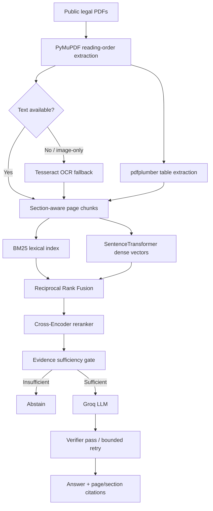

# LexiSyncAI — Evidence-Grounded Legal Document Analyst

A working Streamlit web application for ingesting public legal PDFs, hybrid retrieval, evidence-bound Groq answer generation, citations, abstention, and evaluation.

## Requirements covered

| Assignment requirement | Implementation |
|---|---|
| 2–5 public legal PDFs | Multi-file PDF upload, 1–5 enforced in UI; warning against confidential material |
| PDF reading order | PyMuPDF text blocks sorted top-to-bottom / left-to-right |
| Scanned-page detection and OCR | Low-text pages flagged; optional Tesseract OCR fallback |
| Sections / clauses | Numbered section detection and section-aware chunk splitting |
| Tables | pdfplumber table extraction; table text indexed and shown with evidence |
| BM25 exact lexical retrieval | rank_bm25 with dotted clause IDs retained as atomic tokens |
| Dense transformer retrieval | all-MiniLM-L6-v2 sentence-transformer embeddings |
| Hybrid merge | Reciprocal-rank fusion of BM25 and dense ranks |
| Cross-encoder reranking | ms-marco-MiniLM-L-6-v2 reranks hybrid candidates |
| Recall@k / retrieval comparison | BM25-only, dense-only and hybrid ablation view; see evaluation notes |
| Groq LLM answers | OpenAI-compatible Groq endpoint; user supplies API key |
| Page / clause citations | Each cited passage includes source filename, PDF page and detected section |
| Abstention | Conservative evidence threshold; model instructed to abstain; abstention visible |
| Multi-hop questions | Multiple retrieved passages are supplied together to the model |
| Conflicting sources | Potential repeated metric/value discrepancy detector and model conflict instructions |
| Evaluation | CSV-based held-out evaluation; 15-row template includes 5 unanswerables |
| Latency | Per-question latency and mean latency |
| Manual correctness | Explicitly reserved for human grading rather than fabricated automatic score |
| Bonus: OCR, tables, bounding boxes, verifier, cross-doc conflict, ablation, anomaly diagnostics | Implemented as described; see limitations |

## Run locally

Python 3.11 is recommended.

```bash
python -m venv .venv
# Windows:
.venv\Scripts\activate
# macOS/Linux:
source .venv/bin/activate

pip install -r requirements.txt
streamlit run app.py
```

Open the local Streamlit URL. Enter a Groq key from https://console.groq.com/keys in the sidebar, or set `GROQ_API_KEY` in your environment.

### Docker

```bash
cp .env.example .env
# Edit .env and set GROQ_API_KEY
docker compose up --build
```

Open http://localhost:8501.

## Demo flow (5 minutes)

1. Upload 2–5 public PDFs and click **Extract & index documents**.
2. Show detected pages, OCR flags, tables and extracted text.
3. Ask a clause-number question such as “What does clause 7.2 state?”.
4. Show cited answer, confidence, passage, page and section.
5. Ask something clearly absent (e.g. “What is the signatory's home address?”) and demonstrate abstention.
6. Open **Ablations & diagnostics** and compare BM25, dense and hybrid retrieval.
7. Open **Evaluation**, upload a 15+ row dataset and show abstention/latency metrics.

## Evaluation protocol

Create at least 15 held-out questions grounded in the actual uploaded documents:
- factual questions;
- multi-hop questions requiring evidence from two pages or documents;
- at least 3 unanswerable questions.

The starter CSV is only a schema/example. Replace its expected answers with ground truth from your chosen PDFs. Fill `expected_pages` with comma-separated relevant page numbers for page-level Recall@k and citation scoring. Manually grade answer correctness and citation precision against the PDF. Record the dataset, model name, latency, and any errors in your report.

The application reports abstention accuracy on unanswerable examples, page-label citation matching, page-level Recall@k for BM25/dense/hybrid when expected page labels are supplied, mean latency, and leaves semantic correctness for manual review. This avoids claiming an unverified automated correctness score.

## Architecture



## Security and privacy

- The Groq API key is entered into a password field and is not written to the project files.
- Only retrieved document excerpts are sent to Groq for generation. Do not upload confidential or client material.
- This is a student demonstration tool, not legal advice or a replacement for qualified counsel.

## Known limitations / honest scope

- PDF reading-order reconstruction uses geometric text-block sorting. Complex multi-column layouts, footnotes and unusual layouts should be manually checked.
- OCR requires the Tesseract binary. Docker installs it; on a local machine install Tesseract separately. OCR quality is document-dependent.
- Table extraction is heuristic; merged cells and spanning headers require manual validation.
- Bounding boxes are page-level text-block coordinates, not a high-precision word/claim alignment. Citations remain page-level core citations.
- The current version does not use a VLM to read chart-only evidence; if evidence exists only in a chart/figure, the safe behavior is to abstain.
- Conflict detection is a heuristic flag for repeated named metrics with differing values, not a complete legal contradiction solver.
- The evidence gate is a conservative heuristic and should be calibrated against the evaluation set. Model-generated confidence is not a legal certainty score.
- Retrieval recall@k must be measured using a manually labelled query-to-page relevance file; the app provides configuration ablations, not fabricated recall values.

## Project structure

```text
LexiSyncAI/
├── app.py
├── lexisync/
│   ├── ingestion.py
│   ├── retrieval.py
│   ├── generation.py
│   ├── evaluation.py
│   └── analytics.py
├── requirements.txt
├── Dockerfile
├── docker-compose.yml
├── Makefile
├── .env.example
└── README.md
```
